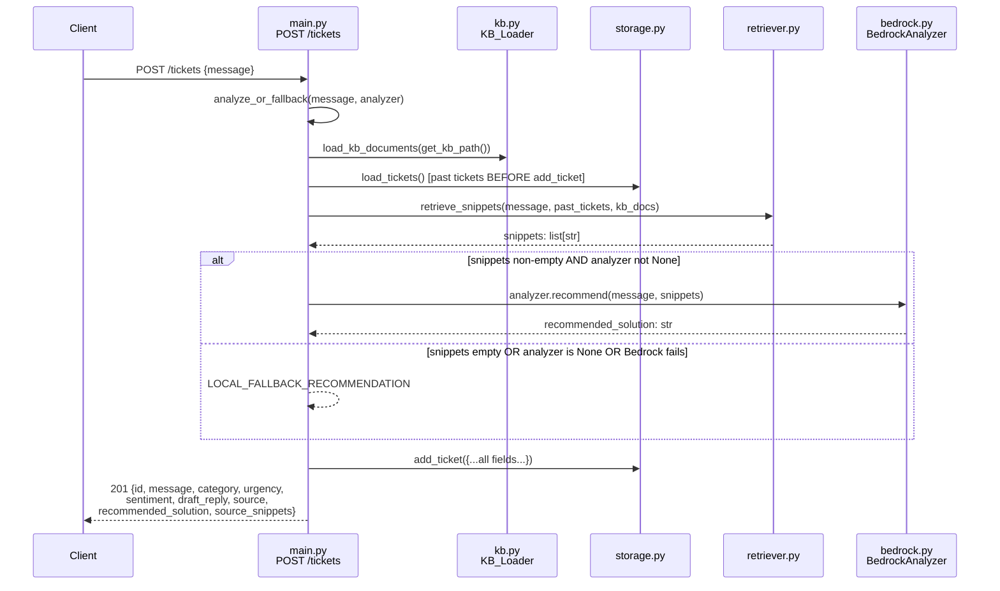

# Design Document: Agent Desk

## Overview

This feature extends the existing ticket desk with a grounded recommended solution on
every new ticket. The current `POST /tickets` route stores category, urgency, sentiment,
draft reply, and source but offers no recommendation backed by real evidence.

The design adds three new components (`kb.py`, `retriever.py`, and an extension to
`bedrock.py`) and updates `main.py` and `page.py` to wire everything together. At ticket
creation time the system: (1) loads `.txt` knowledge-base documents from a configurable
directory, (2) scores past tickets and KB documents against the new ticket's message by
keyword overlap, (3) retrieves the top-3 snippets, and (4) calls Bedrock—or a local
fallback—to produce a `recommended_solution`. Both `recommended_solution` and
`source_snippets` are saved on every ticket and shown on the HTML page.

The design is entirely additive: no existing endpoint, field, or storage behaviour
changes. All new pure functions are tested directly; Bedrock interactions are covered
through FastAPI dependency injection with fake analyzers.

## Architecture



**Component ownership:**

| Module | Role |
|---|---|
| `smart_copilot/kb.py` | KB_Loader: reads `.txt` files from `KB_PATH` |
| `smart_copilot/retriever.py` | Retriever: keyword-overlap scoring, top-N snippet selection |
| `smart_copilot/bedrock.py` | Existing + new `recommend()` method on `BedrockAnalyzer` |
| `smart_copilot/main.py` | Recommendation_Engine: wires KB, Retriever, Bedrock; persists ticket |
| `smart_copilot/page.py` | Updated HTML to render all eight ticket fields |
| `smart_copilot/storage.py` | Unchanged |
| `smart_copilot/classifier.py` | Unchanged |

## Components and Interfaces

### `smart_copilot/kb.py` — KB_Loader

A pure module with no side effects beyond filesystem reads.

```python
def get_kb_path() -> Path:
    """Return KB directory from KB_PATH env var, defaulting to Path('data/kb/')."""
    ...

def load_kb_documents(kb_path: Path) -> list[dict[str, str]]:
    """Read all .txt files from kb_path.

    Returns a list of KB_Documents: {"title": stem, "content": stripped text}.
    A missing or empty directory returns [] without raising.
    Non-.txt files are silently ignored.
    OSError on individual file reads is raised as TicketStoreError (or re-raised
    with context); a non-existent directory is handled before any file read.
    """
    ...
```

**KB_Document shape:** `{"title": str, "content": str}` where `title` is the
filename without its `.txt` extension and `content` is `file_text.strip()`.

**Error policy:** `FileNotFoundError` on the directory → return `[]`. `OSError`
on a specific file read → raise `TicketStoreError` with context.

---

### `smart_copilot/retriever.py` — Retriever

A pure module with no I/O. Uses the same tokeniser pattern as `classifier.py`
(`re.findall(r"[a-z']+", text.lower())`).

```python
def keyword_overlap(query: str, text: str) -> int:
    """Count of distinct lowercase words appearing in both query and text."""
    ...

def retrieve_snippets(
    message: str,
    past_tickets: list[dict[str, Any]],
    kb_docs: list[dict[str, str]],
    top_n: int = 3,
) -> list[str]:
    """Return up to top_n snippets from the combined corpus, scored by keyword overlap.

    Corpus construction (insertion order determines tie-breaking):
      1. Each past ticket contributes: ticket["message"] + " " + ticket["draft_reply"]
      2. Each KB document contributes: doc["content"]

    Scoring: keyword_overlap(message, corpus_item) for each item.
    Returns: top_n items with score > 0, sorted descending by score
             (ties broken by earlier insertion order). Each snippet truncated to
             at most 300 characters.
    An empty corpus or all-zero scores returns [].
    """
    ...
```

**Scoring detail:** Items with `score == 0` are always excluded regardless of
`top_n`. Ties are broken by their position in the corpus (earlier = higher
priority), which means past-ticket strings naturally precede KB-doc strings.

---

### Extension to `smart_copilot/bedrock.py` — `BedrockAnalyzer.recommend()`

Add one method to the existing `BedrockAnalyzer` class. The existing shared
`RateLimiter` singleton governs both `analyze()` and `recommend()`.

```python
RECOMMEND_SYSTEM_PROMPT = (
    "You are a customer support assistant. "
    "Using only the provided context snippets, write a specific, actionable "
    "recommended solution for the customer's issue. "
    "Return only the recommendation text with no markdown, no code blocks, "
    "and no explanation."
)

class BedrockAnalyzer:
    # ... existing analyze() unchanged ...

    def recommend(self, message: str, snippets: list[str]) -> str:
        """Call the Bedrock Converse API with message and snippets.

        Returns the response text string (non-empty).
        Raises BedrockAnalysisError on any failure (same exception classes
        as analyze(): ClientError, BotoCoreError, KeyError/TypeError/IndexError).
        Raises BedrockAnalysisError if the response text is empty.
        """
        ...
```

**Converse call shape** (matches the installed SDK, as confirmed in the
existing `analyze()` implementation):

```python
response = self._client.converse(
    modelId=self._model_id,
    system=[{"text": RECOMMEND_SYSTEM_PROMPT}],
    messages=[{
        "role": "user",
        "content": [{"text": f"Customer message: {message}\n\nContext:\n" + "\n---\n".join(snippets)}],
    }],
)
text: str = response["output"]["message"]["content"][0]["text"]
```

The method raises `BedrockAnalysisError` if `text.strip()` is empty.

---

### Updates to `smart_copilot/main.py`

**Extended `Ticket` Pydantic model:**

```python
class Ticket(BaseModel):
    id: str
    message: str
    category: str
    urgency: str
    sentiment: str
    draft_reply: str
    source: str
    recommended_solution: str          # NEW — non-empty string
    source_snippets: list[str]         # NEW — zero or more snippet strings
```

**New constant:**

```python
LOCAL_FALLBACK_RECOMMENDATION: str = (
    "Please review the ticket manually and consult your team's knowledge base "
    "for the most appropriate resolution."
)
```

**New helper function:**

```python
def recommend_or_fallback(
    message: str,
    snippets: list[str],
    analyzer: BedrockAnalyzer | None,
) -> str:
    """Return Bedrock recommendation or LOCAL_FALLBACK_RECOMMENDATION.

    Returns LOCAL_FALLBACK_RECOMMENDATION when:
    - analyzer is None (BEDROCK_MODEL_ID unset)
    - snippets is empty (no context to ground the recommendation)
    - analyzer.recommend() raises BedrockAnalysisError
    """
    if analyzer is None or not snippets:
        return LOCAL_FALLBACK_RECOMMENDATION
    try:
        return analyzer.recommend(message, snippets)
    except BedrockAnalysisError:
        return LOCAL_FALLBACK_RECOMMENDATION
```

**Updated `create_ticket` route:**

```python
@app.post("/tickets", status_code=201, response_model=Ticket)
def create_ticket(
    body: TicketCreate,
    analyzer: Annotated[BedrockAnalyzer | None, Depends(get_analyzer)],
) -> dict[str, Any]:
    fields, source = analyze_or_fallback(body.message, analyzer)
    # Load past tickets BEFORE add_ticket so the new ticket is not in the corpus
    past_tickets = storage.load_tickets()
    kb_docs = load_kb_documents(get_kb_path())
    snippets = retrieve_snippets(body.message, past_tickets, kb_docs)
    recommended = recommend_or_fallback(body.message, snippets, analyzer)
    ticket: dict[str, Any] = {
        "id": str(uuid.uuid4()),
        "message": body.message,
        **fields,
        "source": source,
        "recommended_solution": recommended,
        "source_snippets": snippets,
    }
    storage.add_ticket(ticket)
    return ticket
```

**New imports added to `main.py`:**

```python
from smart_copilot.kb import get_kb_path, load_kb_documents
from smart_copilot.retriever import retrieve_snippets
```

---

### Updates to `smart_copilot/page.py`

The JavaScript `load()` function in `INDEX_HTML` is extended to render two
additional sections per ticket:

- `recommended_solution`: displayed as a labelled paragraph.
- `source_snippets`: when non-empty, each snippet rendered as a distinct `<div>`
  element with a visual separator; when empty, a single `<em>No source snippets
  available.</em>` line is shown.

No new endpoints, no separate JavaScript app, no CDK.

---

### Test infrastructure additions to `tests/conftest.py`

A new autouse fixture sets `KB_PATH` to a fresh temp directory for every test,
preventing any test from reading real KB files:

```python
@pytest.fixture(autouse=True)
def kb_path(tmp_path: Path, monkeypatch: pytest.MonkeyPatch) -> Path:
    path = tmp_path / "kb"
    path.mkdir()
    monkeypatch.setenv("KB_PATH", str(path))
    return path
```

Tests that need KB documents write `.txt` files into this fixture directory.
Tests that need an empty KB (empty-corpus scenario) leave the directory empty.

## Data Models

### `Ticket` (stored and returned)

| Field | Type | Notes |
|---|---|---|
| `id` | `str` | UUID, generated at creation |
| `message` | `str` | Customer message, 1–5000 chars, non-blank |
| `category` | `str` | One of `billing`, `technical`, `account`, `other` |
| `urgency` | `str` | One of `low`, `medium`, `high` |
| `sentiment` | `str` | One of `negative`, `neutral`, `positive` |
| `draft_reply` | `str` | Non-empty string |
| `source` | `str` | `"bedrock"` or `"local"` |
| `recommended_solution` | `str` | **NEW** — non-empty string |
| `source_snippets` | `list[str]` | **NEW** — zero or more strings, each ≤ 300 chars |

### `KB_Document` (in-memory only, never persisted)

```python
{"title": str, "content": str}
```

`title` is the `.txt` filename stem; `content` is the file text with leading and
trailing whitespace stripped.

### `Snippet` (string, ≤ 300 characters)

Snippets are plain strings derived from corpus items. Each snippet is at most 300
characters; longer corpus items are truncated to exactly 300 characters. Snippets
are stored in `source_snippets` on the `Ticket`.

### Environment Variables

| Variable | Default | Used by |
|---|---|---|
| `TICKETS_FILE` | `data/tickets.json` | `storage.py` |
| `KB_PATH` | `data/kb/` | `kb.py` |
| `BEDROCK_MODEL_ID` | _(unset → no Bedrock)_ | `bedrock.py` |
| `AWS_REGION` | `us-east-1` | `bedrock.py` |

## Correctness Properties

*A property is a characteristic or behavior that should hold true across all
valid executions of a system — essentially, a formal statement about what the
system should do. Properties serve as the bridge between human-readable
specifications and machine-verifiable correctness guarantees.*

---

### Property 1: KB loader returns exactly the .txt files with correct metadata

*For any* directory containing a mix of `.txt` and non-`.txt` files,
`load_kb_documents` returns exactly one `KB_Document` per `.txt` file, with
`title` equal to the filename stem and `content` equal to the file text with
leading and trailing whitespace stripped; no non-`.txt` file appears in the
result.

**Validates: Requirements 1.1, 1.5**

---

### Property 2: Retriever returns only positive-scored snippets in score order

*For any* query message and corpus (built from any combination of past tickets
and KB documents), `retrieve_snippets` returns at most `top_n` snippets, every
returned snippet has a `keyword_overlap` score strictly greater than zero with
the query, and the snippets are sorted in descending order of score with ties
broken by their position in the corpus (earlier insertion first, meaning
past-ticket items precede KB-doc items).

**Validates: Requirements 2.1, 2.3, 2.4, 2.8**

---

### Property 3: Snippet length invariant

*For any* corpus item of string length `L`, its snippet as returned by
`retrieve_snippets` has length `min(L, 300)`: strings longer than 300 characters
are truncated to exactly 300 characters, and strings of 300 characters or fewer
are returned in full.

**Validates: Requirements 2.5, 2.6**

---

### Property 4: Keyword overlap is case-invariant

*For any* query string `q` and corpus text `t`,
`keyword_overlap(q, t) == keyword_overlap(q.upper(), t) == keyword_overlap(q, t.lower()) == keyword_overlap(q.upper(), t.upper())`:
changing the letter case of either argument does not change the overlap count.

**Validates: Requirements 2.7**

---

### Property 5: `recommend_or_fallback` always returns a non-empty string

*For any* combination of `message` (non-blank string), `snippets` (any list
including empty), and `analyzer` (None, an analyzer that raises
`BedrockAnalysisError`, or an analyzer that returns any string including empty),
`recommend_or_fallback` returns a non-empty string — either the Bedrock response
or `LOCAL_FALLBACK_RECOMMENDATION`.

**Validates: Requirements 3.1, 5.2**

---

### Property 6: Ticket persistence preserves all nine fields

*For any* ticket created via `POST /tickets`, loading it back from storage
returns a dict that (a) contains `recommended_solution` as a non-empty string,
(b) contains `source_snippets` as a list of strings, and (c) has all seven
pre-existing fields (`id`, `message`, `category`, `urgency`, `sentiment`,
`draft_reply`, `source`) with values identical to those in the creation response.

**Validates: Requirements 3.2, 3.3, 3.4**

## Error Handling

### KB_Loader (`kb.py`)

| Situation | Behaviour |
|---|---|
| `KB_PATH` directory does not exist | Return `[]`; do not raise |
| `KB_PATH` directory exists but is empty | Return `[]`; do not raise |
| File in directory cannot be read (`OSError`) | Raise `TicketStoreError` with context |
| File has no `.txt` extension | Silently skip |

The existing `TicketStoreError` exception handler in `main.py` returns HTTP 500
for unreadable files; this is consistent with how storage failures are already
handled.

### Retriever (`retriever.py`)

The retriever is a pure function with no I/O and therefore raises no exceptions.
An empty corpus or an all-zero-score corpus returns `[]`.

### Recommendation_Engine (`main.py` — `recommend_or_fallback`)

| Situation | Behaviour |
|---|---|
| `analyzer is None` (`BEDROCK_MODEL_ID` unset) | Return `LOCAL_FALLBACK_RECOMMENDATION`; do not call `recommend()` |
| `snippets` is empty | Return `LOCAL_FALLBACK_RECOMMENDATION`; do not call `recommend()` |
| `analyzer.recommend()` raises `BedrockAnalysisError` | Catch; return `LOCAL_FALLBACK_RECOMMENDATION` |
| `analyzer.recommend()` returns non-empty string | Return that string |

In every case the response to `POST /tickets` is HTTP 201. HTTP 500 is never
returned due to a Bedrock failure.

### `BedrockAnalyzer.recommend()` (`bedrock.py`)

| Situation | Behaviour |
|---|---|
| `ClientError` from boto3 | Raise `BedrockAnalysisError` |
| `BotoCoreError` from boto3 | Raise `BedrockAnalysisError` |
| Response text is empty or whitespace | Raise `BedrockAnalysisError` |
| `KeyError`, `TypeError`, `IndexError` on response shape | Raise `BedrockAnalysisError` |

The rate limiter's `wait()` is called before every Bedrock call, covering both
`analyze()` and `recommend()` through the shared singleton, keeping total Bedrock
calls under 1 request per second.

## Testing Strategy

### Framework and library

- **Unit / example tests:** `pytest` (already in use)
- **Property-based tests:** `hypothesis` (already in `.venv`; used in
  `test_bedrock_properties.py`)
- Property tests run a minimum of 100 iterations each (Hypothesis default
  settings with `@given`).

### Test file layout

```
tests/
  conftest.py                 — add kb_path autouse fixture
  test_kb.py                  — KB_Loader unit + property tests
  test_retriever.py           — Retriever unit + property tests
  test_agent_desk_api.py      — Route-level integration tests (fake analyzer)
  test_agent_desk_properties.py — Hypothesis property tests for Properties 1–6
```

### Unit tests (example-based)

**`test_kb.py`**

- Missing directory → `[]`, no exception
- Empty directory → `[]`, no exception
- Directory with `.txt` files → correct title (stem), content stripped
- Non-`.txt` files ignored
- Mixed `.txt` and non-`.txt` → only `.txt` returned
- `KB_PATH` env var is read; `get_kb_path()` defaults to `Path("data/kb/")`

**`test_retriever.py`**

- Empty corpus → `[]`
- All-zero scores → `[]`
- Top-3 selection with known scores
- 300-char truncation (item > 300 chars → exactly 300 chars)
- No truncation (item ≤ 300 chars → full string)
- Tie-breaking: past-ticket item before KB-doc item with equal score
- Case-insensitive matching ("Hello" and "hello" count as the same word)

**`test_agent_desk_api.py`** (uses `TestClient`, fake analyzer)

- Bedrock available + returns recommendation → `recommended_solution` = Bedrock string
- Bedrock raises `BedrockAnalysisError` → fallback, `source_snippets` = retrieved snippets, HTTP 201
- `BEDROCK_MODEL_ID` unset (analyzer = None) → fallback, HTTP 201
- Empty corpus (no past tickets, no KB files) → `source_snippets = []`, fallback
- `recommend()` called with exactly `(message, snippets)` — verified via spy
- `GET /` HTML contains all eight field labels per ticket
- `GET /` with non-empty `source_snippets` → each snippet rendered separately
- `GET /` with empty `source_snippets` → "no source snippets" indication shown

**Rate limiter test (extend existing `test_bedrock.py`)**

- `recommend()` calls `rate_limiter.wait()` before the Bedrock call

### Property-based tests with Hypothesis (`test_agent_desk_properties.py`)

Each property test references its design document property in a tag comment.

**Property 1 — KB loader .txt filter:**
`@given(st.lists(st.text(...), min_size=0))` — generate filenames with varying
extensions; write them to the `kb_path` fixture directory; call
`load_kb_documents`; assert only `.txt` files appear with correct title and
stripped content.
*Feature: agent-desk, Property 1: KB loader returns exactly the .txt files with correct metadata*

**Property 2 — Retriever positive-score ordering:**
`@given(st.text(...), st.lists(st.dictionaries(...)))` — generate random query
messages and corpora; call `retrieve_snippets`; assert all returned snippets have
score > 0 and are in non-increasing score order.
*Feature: agent-desk, Property 2: Retriever returns only positive-scored snippets in score order*

**Property 3 — Snippet length invariant:**
`@given(st.text(min_size=0))` — generate corpus item strings of varying lengths;
call `retrieve_snippets` with a matching query; assert each snippet length equals
`min(len(original), 300)`.
*Feature: agent-desk, Property 3: Snippet length invariant*

**Property 4 — Keyword overlap case-invariance:**
`@given(st.text(...), st.text(...))` — generate query and text strings; assert
`keyword_overlap(q, t) == keyword_overlap(q.upper(), t.lower())`.
*Feature: agent-desk, Property 4: Keyword overlap is case-invariant*

**Property 5 — `recommend_or_fallback` non-empty:**
`@given(st.text(min_size=1), st.lists(st.text(...)))` combined with analyzer
variants (None, raising fake, non-empty-returning fake, empty-string-returning
fake); assert returned string is non-empty.
*Feature: agent-desk, Property 5: recommend_or_fallback always returns a non-empty string*

**Property 6 — Ticket persistence round-trip:**
`@given(st.text(min_size=1, max_size=5000).filter(str.strip))` — POST a generated
message via `TestClient`; then `GET /tickets`; assert the returned ticket contains
all nine fields with `recommended_solution` non-empty and `source_snippets` a list
of strings, and the seven pre-existing fields match the POST response.
*Feature: agent-desk, Property 6: Ticket persistence preserves all nine fields*

### No live AWS

All tests inject a fake `BedrockAnalyzer` via `app.dependency_overrides[get_analyzer]`.
The `conftest.py` `reset_analyzer_override` fixture (already autouse) clears the
override after each test. No `boto3` client is created during tests.
