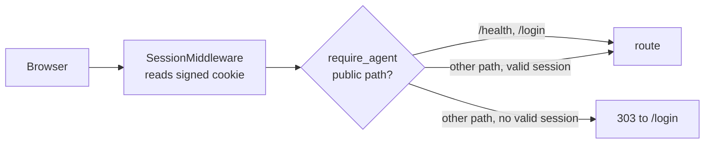
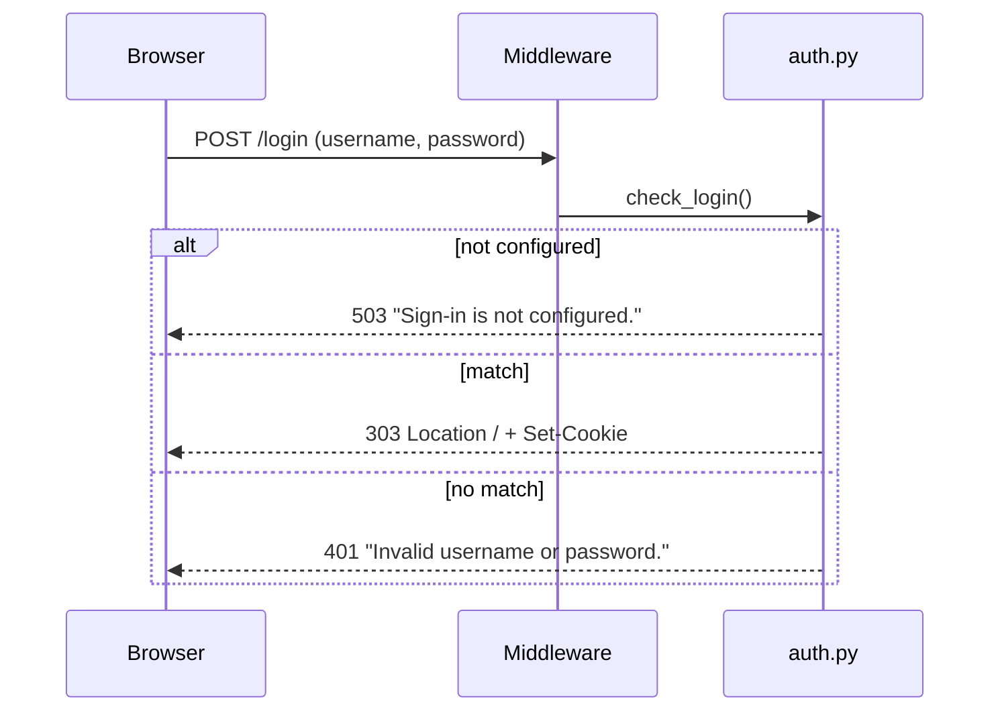

# Design Document: Agent Sign-In

Requirements: `.kiro/specs/agent-sign-in/requirements.md`. BRD: `docs/brd-agent-sign-in.md`.

## Overview

The feature adds a username and password sign-in for one support agent. It uses Starlette's `SessionMiddleware` for a signed cookie, a deny-by-default HTTP middleware that sends visitors without a session to `/login`, and two new routes for the login form. Password hashing uses the standard library (`hashlib.pbkdf2_hmac` and `hmac.compare_digest`). No AWS service, database, or classifier change is involved.

`.kiro/steering/product.md` lists user login as out of scope until an approved spec adds it. This spec is that request.

### Decisions and rationale

| Decision | Rationale |
|---|---|
| Starlette 1.10.0 `SessionMiddleware`, signed cookie (itsdangerous `TimestampSigner`) | Standard FastAPI path. `max_age` is enforced on the server when the cookie is unsigned, so an old cookie is rejected even if the browser still sends it. Hand-rolled cookie signing was rejected as easy to get wrong. |
| Middleware, not a per-route dependency | Middleware is deny-by-default (Requirement 4.6) and runs before the body is parsed. A logged-out `POST /tickets` with a bad body gets 303, not 422 (Requirement 4.2). |
| Standard-library PBKDF2-HMAC-SHA256, 600,000 iterations | Follows the OWASP Password Storage Cheat Sheet. No new dependency. The iteration count is stored in the hash, so tests can use 1000. |
| 303 redirect for logged-out API calls | Requested in the BRD. A script calling the API receives the login page HTML. |
| 401 with the login page for a wrong sign-in | BRD decision. |
| `https_only=False` | The lab serves `http://localhost`. Turning it on would stop the browser from sending the cookie. Change it before any HTTPS deployment, which is out of scope. |
| No sign-out | Out of scope. Clearing cookies or waiting 8 hours ends a session. |

### Dependencies

Neither package is installed now (checked in `.venv` and `uv.lock`).

| Package | Why | Command |
|---|---|---|
| `itsdangerous` | Imported by `starlette.middleware.sessions` to sign the cookie | `uv add itsdangerous` |
| `python-multipart` | FastAPI needs it to parse `Form(...)` fields on `POST /login` | `uv add python-multipart` |
| `hypothesis` (dev) | Property-based tests. Not installed now. | `uv add --dev hypothesis` |

## Architecture



Middleware order matters. Starlette's `add_middleware` inserts at position 0, so the last one added is outermost. `require_agent` is registered first and `SessionMiddleware` is added after it. `SessionMiddleware` therefore runs first and `request.session` exists when `require_agent` reads it. A test proves the order by checking that a signed-in request is not redirected.



## Components and Interfaces

### `src/smart_copilot/auth.py` (new)

Single purpose: credentials and the session check. It does no logging.

```python
SESSION_KEY = "agent"
SESSION_MAX_AGE = 8 * 60 * 60          # 28,800 seconds
PUBLIC_PATHS = frozenset({"/health", "/login"})

class AuthNotConfigured(Exception): ...

def hash_password(password: str, iterations: int = 600_000) -> str:
    """Return "pbkdf2_sha256$<iterations>$<salt_hex>$<hash_hex>". Salt is secrets.token_bytes(16)."""

def verify_password(password: str, encoded: str) -> bool:
    """Recompute with pbkdf2_hmac and compare with hmac.compare_digest.
    Raises AuthNotConfigured if `encoded` is malformed."""

def agent_credentials() -> tuple[str, str]:
    """Read AGENT_USERNAME and AGENT_PASSWORD_HASH at call time.
    Raises AuthNotConfigured if either is unset or empty."""

def check_login(username: str, password: str) -> bool:
    """Compare the username with hmac.compare_digest and always run verify_password,
    so timing does not reveal whether the username exists. Raises AuthNotConfigured."""

def session_secret() -> str:
    """SESSION_SECRET, or secrets.token_urlsafe(32) when unset or empty.
    The random value is generated once per process."""

def is_signed_in(session: dict) -> bool:
    """True when session.get(SESSION_KEY) equals the configured username."""
```

- Credentials are read at call time, so tests can use `monkeypatch.setenv`.
- `is_signed_in` compares with the configured username, so changing `AGENT_USERNAME` ends old sessions. If the account is not configured, it returns False.
- `session_secret()` is called once when `main.py` builds the middleware. A random key means every session issued before a restart is rejected after it (Requirement 6.6).
- `username` and `password` are compared as UTF-8 bytes, so `compare_digest` accepts non-ASCII input.
- Running `uv run python -m smart_copilot.auth` prompts twice with `getpass.getpass`. It prints only the hash. On an empty password or two passwords that differ, it prints an error to stderr, prints no hash, and exits non-zero. It accepts no password as an argument (Requirements 6.8, 6.9).

### `src/smart_copilot/main.py` (changed)

- `require_agent` is an `@app.middleware("http")` function. If `request.url.path` is not in `PUBLIC_PATHS` and `is_signed_in(request.session)` is false, it returns `RedirectResponse("/login", status_code=303)` without calling the route. This also covers paths that match no route (Requirement 4.7).
- After it, `app.add_middleware(SessionMiddleware, secret_key=session_secret(), max_age=SESSION_MAX_AGE, same_site="lax", https_only=False)`. The cookie is HTTP-only by default.
- `GET /login` returns `login_page()` with status 200.
- `POST /login` takes `username: str = Form("")` and `password: str = Form("")`:
  - `AuthNotConfigured`: status 503, login page with "Sign-in is not configured.", no session.
  - `check_login` true: `request.session.clear()`, then `request.session["agent"] = username`, then a 303 redirect to `/`.
  - Otherwise: status 401, login page with "Invalid username or password.", no session.
- The ticket routes, `GET /health`, and `store_error_handler` are unchanged.

### `src/smart_copilot/page.py` (changed)

- `LOGIN_HTML`: a template with `<form method="post" action="/login">`, one `<input name="username" autocomplete="username">`, one `<input type="password" name="password" autocomplete="current-password">`, one submit button, and an error slot.
- `login_page(error: str = "") -> str` inserts the error with `html.escape`. Only the two fixed messages are passed in. The inputs never carry a `value`, so a submitted username or password is never echoed (Requirements 1.4, 3.5).
- `INDEX_HTML` gets a helper `toLoginIfRedirected(res)`. When `res.redirected` is true and `new URL(res.url).pathname === "/login"`, it sets `window.location = "/login"` and returns true. The caller then returns at once, so no error message is shown and no rows are rendered. It is called after each of the three `fetch` calls (`GET /tickets`, `POST /tickets`, `DELETE /tickets/{id}`) before the body is read. A browser follows the 303 silently, so `fetch` sees a 200 HTML response with `redirected` set. Other responses keep their existing handling (Requirement 7.5).

### Unchanged

`classifier.py`, `storage.py`, the ticket request and response models, and `data/tickets.json`.

## Data Models

No stored data is added. The ticket file format does not change.

| Item | Shape | Source |
|---|---|---|
| Agent username | string | `AGENT_USERNAME` env var |
| Password hash | `pbkdf2_sha256$<iterations>$<salt_hex>$<hash_hex>` | `AGENT_PASSWORD_HASH` env var |
| Session signing key | string | `SESSION_SECRET` env var, or random per process |
| Session cookie | Starlette signed cookie holding `{"agent": "<username>"}`; HTTP-only, `SameSite=Lax`, `Max-Age=28800` | `SessionMiddleware` |
| Login form | `username`, `password` (form-encoded, both default to `""`) | `POST /login` |

A hash is malformed when it does not have four `$`-separated parts, the first is not `pbkdf2_sha256`, the iteration count is not a positive integer, or either hex part does not decode.

## Correctness Properties

*A property is a characteristic or behavior that should hold true across all valid executions of a system-essentially, a formal statement about what the system should do. Properties serve as the bridge between human-readable specifications and machine-verifiable correctness guarantees.*

Prework reflection: the wrong-sign-in criteria (1.4, 3.1 to 3.5) share the same generated input and are merged into Property 2. The hash round trip and the wrong-password check (6.2) are merged into Property 1. Fixed-value criteria (cookie attributes, the 8-hour boundary, not-configured states, the login page layout, the browser script) are example tests, not properties.

### Property 1: Password verification matches equality

For any two strings `p` and `q`, `verify_password(q, hash_password(p, iterations=1000))` is true if and only if `p == q`, and the hash it checks has the form `pbkdf2_sha256$<iterations>$<salt_hex>$<hash_hex>`.

**Validates: Requirements 6.1, 6.2, 6.8**

### Property 2: Any wrong credentials give one uniform failure

For any username and password strings, other than the pair `(test-agent, FAKE_PASSWORD)` (including empty, whitespace-only, and non-ASCII strings), `POST /login` returns status 401 and a body equal to the body returned for a known-wrong password, with no `Set-Cookie` header. Neither the submitted username nor the submitted password appears in the body or the headers, and a following `GET /tickets` is redirected to `/login`.

**Validates: Requirements 1.4, 3.1, 3.2, 3.3, 3.4, 3.5**

### Property 3: Protected routes never serve data without a session

For any protected method and path (`GET /`, `GET /tickets`, `POST /tickets` with any body, `DELETE /tickets/{id}` with any id, and any path that matches no route), a request with no session cookie returns status 303 with `Location: /login`, a body with no ticket data, and leaves the tickets file byte-for-byte unchanged, including when the file holds tickets.

**Validates: Requirements 4.1, 4.2, 4.3, 4.7**

### Property 4: Any invalid session cookie is rejected

For any session cookie value that is arbitrary text, a valid cookie with any character changed, or a cookie signed with a different secret, a request to a protected route returns status 303 with `Location: /login`, and a request to `GET /health` or `GET /login` is answered as it is for a visitor without a session.

**Validates: Requirements 4.4, 5.4**

## Error Handling

| Case | Result |
|---|---|
| `AGENT_USERNAME` or `AGENT_PASSWORD_HASH` unset, empty, or malformed hash | `POST /login` returns 503 "Sign-in is not configured.", no session, app keeps running |
| Wrong username or password, or an empty or missing field | 401 "Invalid username or password.", the same body in every case |
| Missing, tampered, foreign-key, or expired cookie | `SessionMiddleware` drops it, `require_agent` redirects to `/login` |
| Empty or mismatched password in the hash command | Error on stderr, no hash printed, non-zero exit |
| Storage errors while signed in | Unchanged, 500 from `store_error_handler` |

Nothing in `auth.py`, the login route, or the middleware logs usernames, passwords, hashes, or the secret.

## Testing Strategy

All tests use pytest and FastAPI's `TestClient`. No test calls Bedrock or any AWS service, and the suite must pass with no AWS credentials. `TICKETS_FILE` is set to a temporary file by the existing autouse fixture, so `data/tickets.json` is never touched.

### Fixtures (`tests/conftest.py`)

- `FAKE_PASSWORD = "fake-password-for-tests"`, a constant marked as a test-only value. It is not a real credential and appears only in test code.
- An autouse fixture sets `AGENT_USERNAME=test-agent`, `AGENT_PASSWORD_HASH=hash_password(FAKE_PASSWORD, iterations=1000)`, and `SESSION_SECRET=test-session-secret`.
- `anon_client` is a `TestClient` with no session.
- `client` keeps its name and signs in through `POST /login` first, so existing tests run as the agent with no assertion changed.
- Tests that assert a 303 and its `Location` use `follow_redirects=False`.

### Unit and example tests

- Login page: one username input, one `type="password"` input, one submit, form posting to `/login`; reachable with no session, with a session, and with sign-in unconfigured (Requirement 1).
- Correct sign-in: 303 to `/`; `Set-Cookie` has `HttpOnly`, `SameSite=lax`, and `Max-Age=28800`; the desk and `GET /tickets` return the existing shapes and ordering; a failed attempt followed by a correct one signs in (Requirement 2, 3.8).
- Not configured: parametrized over unset, empty, and malformed hash gives 503 and no cookie (Requirements 3.7, 6.4).
- Expired session: build a cookie, then advance the time seen by itsdangerous's `TimestampSigner` (check the installed `itsdangerous` source for the exact time call when implementing) or build a cookie with an old timestamp. A cookie older than 28,800 seconds is redirected (Requirements 2.7, 4.4).
- Secret handling: a cookie signed with another secret is rejected; with `SESSION_SECRET` unset, two separate processes' keys differ (Requirement 6.6).
- Public list: iterate `app.routes` with no session. Every route not in `{/health, /login}` returns 303 (Requirement 4.6). `GET /health` returns `{"status": "ok"}` and does not change the tickets file (Requirement 5).
- Logging: with `caplog`, a failed and a successful sign-in leave no username, password, hash, or secret in the log records (Requirements 3.6, 6.7).
- Hash command: patch `getpass.getpass`. A matching pair prints one hash that `verify_password` accepts. An empty password and mismatched passwords exit non-zero and print no hash (Requirements 6.8, 6.9).
- Scope: `git diff --exit-code src/smart_copilot/classifier.py` is clean (Requirement 8.4).

### Requirement 7 limit

Requirement 7 is browser JavaScript, and pytest does not run a browser. The pytest check only reads `INDEX_HTML` and asserts that the `toLoginIfRedirected` helper exists, tests `res.redirected` and the `/login` path, and is called after each of the three `fetch` calls. It does not prove the redirect happens in a browser. That check is done by hand with the Playwright MCP tools already set up in this workspace: sign in, expire or clear the cookie, then load, add, and delete a ticket and confirm each lands on `/login` with no error message.

### Property-based tests

Properties 1 to 4 are written with the Hypothesis library (`uv add --dev hypothesis`). They are not implemented from scratch.

- Each property is one test with `@settings(max_examples=100)` or more.
- Each test carries a comment in the form `# Feature: agent-sign-in, Property <n>: <property text>`.
- Property 1 builds hashes with `iterations=1000` to keep 100 runs fast.
- Properties 2 to 4 create a `TestClient` inside the test, not through a function-scoped fixture, or use `HealthCheck.function_scoped_fixture` suppression, because Hypothesis reuses function-scoped fixtures across examples. Property 3 resets the tickets file for each example and compares its bytes before and after.
