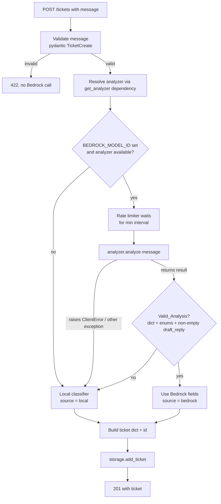

# Design Document

## Overview

This feature makes Amazon Bedrock the primary analyzer for a ticket's four
analysis fields (`category`, `urgency`, `sentiment`, `draft_reply`), computed
inside `POST /tickets` at creation time, while keeping the existing local
keyword classifier (`classifier.py`) as a reliable fallback. Every ticket gains
a new `source` field recording whether the four fields came from `bedrock` or
`local`. The Bedrock call sends only the ticket message text. On any Bedrock
problem (exception, throttle, malformed output, out-of-enum value, or unset
model id) the system falls back to the local classifier and still returns 201.

The source of truth is `docs/brd-bedrock-analysis.md`. This design keeps the
scope stated there: analysis happens only inside `POST /tickets`, no
`POST /tickets/{id}/analyze` endpoint, no grounding on past tickets or
knowledge-base documents, no S3 or other AWS service, and no infrastructure
code.

### Research notes

The following facts were confirmed by reading the existing code and steering
before writing this design:

- `main.py` builds the ticket dict in `create_ticket` from
  `classify_category`, `classify_urgency`, `classify_sentiment`, and
  `draft_reply`, then calls `storage.add_ticket`. The `Ticket` pydantic model
  lists exactly `id`, `message`, `category`, `urgency`, `sentiment`,
  `draft_reply`. Adding `source` means updating this model and the stored dict.
- `classifier.py` exposes the four pure functions this design reuses for the
  fallback. The allowed enum values live implicitly in `classifier.py`
  (`billing|technical|account|other`, `low|medium|high`,
  `negative|neutral|positive`); this design restates them as explicit
  constants used by the validation function.
- `storage.py` persists an arbitrary ticket dict to `data/tickets.json`
  (path overridable with `TICKETS_FILE`). It stores whatever keys the dict
  carries, so a new `source` key needs no storage change.
- `page.py` renders each ticket's `category`, `urgency`, `sentiment`, and
  `draft_reply`; it needs a one-line addition to also show `source`.
- `boto3` is **not** yet a dependency (`pyproject.toml` lists only `fastapi`
  and `uvicorn`). The build agent adds it with `uv add boto3` per steering.
- The existing test `test_create_returns_201_and_full_ticket` asserts the
  exact set of ticket keys; adding `source` will require updating that test.

Per the `verify-first` steering, the exact `boto3` `bedrock-runtime`
request/response shape (operation name, request body, and the path to the
model's text in the response) MUST be confirmed from the installed SDK at build
time. This design describes that interaction abstractly and does not assert a
specific method name or response field path as if confirmed.

## Architecture

The feature adds one module, `src/smart_copilot/bedrock.py`, and changes the
create flow in `main.py`. The analyzer is supplied to the route through a
FastAPI dependency so tests can override it with a fake.

### Request flow for `POST /tickets`



Key points:

- Message validation is unchanged and runs first. An invalid message returns
  422 and never reaches Bedrock.
- Exactly one `analyze` call happens per create, and only after the rate
  limiter allows it. There is no loop over tickets.
- Every path that is not a `Valid_Analysis` converges on the local fallback,
  so the only way to reach `source = bedrock` is a successful, valid result.
- A Bedrock problem never produces a 500. Storage errors remain the only 500
  path and are unchanged.

### Module layout

| Module | Change |
| --- | --- |
| `src/smart_copilot/bedrock.py` | **New.** `BedrockAnalyzer` wrapper, allowed-enum constants, `is_valid_analysis` validation, `RateLimiter`, and the `get_analyzer` dependency factory. |
| `src/smart_copilot/main.py` | Inject the analyzer into `create_ticket`; choose Bedrock-or-local; set `source`; add `source` to the `Ticket` model. |
| `src/smart_copilot/classifier.py` | Unchanged; reused for the fallback. |
| `src/smart_copilot/storage.py` | Unchanged; stores the extra `source` key as-is. |
| `src/smart_copilot/page.py` | Show `source` for each ticket. |

## Components and Interfaces

### `BedrockAnalyzer` (new, in `bedrock.py`)

A small wrapper around a `boto3` `bedrock-runtime` client exposing one public
method.

```python
class BedrockAnalyzer:
    def __init__(self, client: Any, model_id: str, rate_limiter: "RateLimiter") -> None: ...

    def analyze(self, message: str) -> dict[str, Any]:
        """Send only the message text to the configured model and return a dict
        with keys category, urgency, sentiment, draft_reply."""
```

Behavior:

- `analyze` passes **only** the ticket message text to the model (Requirement
  7). It does not read past tickets, storage, or any S3 object.
- Before invoking the client, it asks the injected `RateLimiter` to wait, so
  calls stay under 1 request per second (Requirement 8).
- It invokes the configured model (`model_id`) through the `boto3`
  `bedrock-runtime` client, reads the model's returned text, and parses it as
  JSON into the four fields. The **exact** `boto3` operation name, request body
  structure, and response field path are confirmed from the installed SDK at
  build time and are intentionally not fixed here.
- I/O and AWS errors are handled with specific exceptions (for example
  `botocore.exceptions.ClientError` for throttling and other client errors,
  `json.JSONDecodeError` for unparseable model text, and `KeyError`/`TypeError`
  for an unexpected response shape). `analyze` either returns a dict or raises;
  the caller in `main.py` treats any raised exception as a Bedrock_Failure.

The wrapper never hard-codes a model id and never embeds credentials; the
client uses the default AWS credential chain and the region from `AWS_REGION`
(default `us-east-1`).

### `get_analyzer` dependency (new, in `bedrock.py`)

A FastAPI dependency factory that returns a `BedrockAnalyzer` or `None`.

```python
def get_analyzer() -> BedrockAnalyzer | None:
    """Return a configured analyzer, or None when BEDROCK_MODEL_ID is unset."""
```

Behavior:

- Reads `BEDROCK_MODEL_ID` from the environment. When it is unset or empty,
  returns `None`, which signals the route to use the local classifier with
  `source = local` and status 201 (Requirement 6). It never raises or returns
  503.
- When set, reads `AWS_REGION` (default `us-east-1`), constructs the
  `bedrock-runtime` client, and returns a `BedrockAnalyzer` wrapping it, a
  shared `RateLimiter`, and the model id.
- `create_ticket` depends on it via `analyzer: BedrockAnalyzer | None =
  Depends(get_analyzer)`. Tests override it with
  `app.dependency_overrides[get_analyzer] = lambda: fake_analyzer`, so no live
  Bedrock client is constructed and no network call happens during tests
  (Requirement 9). The override is cleared after each test.

### `is_valid_analysis` validation function (new, in `bedrock.py`)

```python
def is_valid_analysis(result: Any) -> bool:
    """True iff result is a dict with category in ALLOWED_CATEGORIES, urgency in
    ALLOWED_URGENCIES, sentiment in ALLOWED_SENTIMENTS, and a non-empty string
    draft_reply."""
```

- Pure function, no I/O. Returns `False` for anything that is not a dict, is
  missing a required key, has a wrong-typed value, carries an out-of-enum
  value, or has an empty/blank `draft_reply` (Requirements 4.6, 5.1-5.3).
- The allowed enums are module-level frozen sets:
  `ALLOWED_CATEGORIES = {"billing", "technical", "account", "other"}`,
  `ALLOWED_URGENCIES = {"low", "medium", "high"}`,
  `ALLOWED_SENTIMENTS = {"negative", "neutral", "positive"}`.

### `RateLimiter` (new, in `bedrock.py`)

```python
class RateLimiter:
    def __init__(self, min_interval_seconds: float = 1.0) -> None: ...
    def wait(self) -> None:
        """Block until at least min_interval_seconds have passed since the last call."""
```

- Uses a monotonic clock (`time.monotonic`) and records the last call time.
  `wait` sleeps for the remaining time if the previous call was less than
  `min_interval_seconds` ago, then records the new time. Guarded by a lock so a
  single shared limiter is safe if the app is threaded.
- With a default interval of 1.0 second, two consecutive `analyze` calls cannot
  both start within the same 1-second window (Requirement 8.1).

### `create_ticket` flow change (in `main.py`)

```python
@app.post("/tickets", status_code=201, response_model=Ticket)
def create_ticket(
    body: TicketCreate,
    analyzer: BedrockAnalyzer | None = Depends(get_analyzer),
) -> dict[str, Any]:
    fields, source = analyze_or_fallback(body.message, analyzer)
    ticket = {"id": str(uuid.uuid4()), "message": body.message, **fields, "source": source}
    storage.add_ticket(ticket)
    return ticket
```

- A helper (`analyze_or_fallback`, in `main.py` or `bedrock.py`) encapsulates
  the decision: if `analyzer is None`, use local and `source = "local"`;
  otherwise call `analyzer.analyze(message)` inside a `try`, and if it raises a
  specific caught exception **or** `is_valid_analysis` returns `False`, use
  local and `source = "local"`; on a valid result use its four fields and
  `source = "bedrock"`.
- The local branch reuses `classify_category`, `classify_urgency`,
  `classify_sentiment`, and `draft_reply` exactly as today, so a `local` ticket
  is identical to today's ticket plus the `source` field.
- Message validation (`TicketCreate`) is unchanged, so 422 behavior is
  preserved and no Bedrock call happens for an invalid message.

### `page.py` change

Add one rendered line per ticket showing `source`, placed with the existing
meta line. The four analysis fields already display; this change only surfaces
the new field. Example addition inside the per-ticket render:

```js
line(box, "meta", "Source: " + t.source);
```

## Data Models

### Ticket (stored dict and pydantic `Ticket` model)

The `Ticket` model gains one field; all existing fields stay.

| Field | Type | Values | Notes |
| --- | --- | --- | --- |
| `id` | `str` | UUID4 string | Unchanged. |
| `message` | `str` | 1-5000 chars, not blank | Unchanged; stored verbatim. |
| `category` | `str` | `billing` \| `technical` \| `account` \| `other` | From Bedrock on success, else local. Always in enum. |
| `urgency` | `str` | `low` \| `medium` \| `high` | From Bedrock on success, else local. Always in enum. |
| `sentiment` | `str` | `negative` \| `neutral` \| `positive` | From Bedrock on success, else local. Always in enum. |
| `draft_reply` | `str` | non-empty | From Bedrock on success, else local. |
| `source` | `str` | `bedrock` \| `local` | **New.** `bedrock` only on a Valid_Analysis; `local` on every fallback path. |

```python
class Ticket(BaseModel):
    id: str
    message: str
    category: str
    urgency: str
    sentiment: str
    draft_reply: str
    source: str
```

The stored JSON shape in `data/tickets.json` is the same object; `storage.py`
writes the dict as-is, so no storage migration is needed. Existing tickets
without a `source` field are out of scope (the BRD covers newly created
tickets); listing still works because `GET /tickets` uses `.get` for ordering.

### Bedrock analyzer result (in-memory only)

`analyze` returns a transient dict with keys `category`, `urgency`,
`sentiment`, `draft_reply`. It is validated by `is_valid_analysis` and, if
valid, its four values are copied onto the ticket. It is never stored on its
own.

## Correctness Properties

*A property is a characteristic or behavior that should hold true across all
valid executions of a system-essentially, a formal statement about what the
system should do. Properties serve as the bridge between human-readable
specifications and machine-verifiable correctness guarantees.*

Most acceptance criteria for this feature are wiring and status checks best
covered by example and smoke tests (see Testing Strategy), because their
behavior does not vary meaningfully with input (a canned fake either returns a
valid result or fails). Three elements are genuinely universal and are stated
as properties below: the pure validation predicate, the route-level fallback
guarantee across every failure kind, and the stored-enum invariant.

### Property 1: Validation accepts only well-formed, in-enum results

*For any* value, `is_valid_analysis` returns `True` if and only if the value is
a dict whose `category` is in the allowed categories, `urgency` is in the
allowed urgencies, `sentiment` is in the allowed sentiments, and `draft_reply`
is a non-empty string; any missing key, wrong-typed value, out-of-enum value,
non-dict input, or empty/blank `draft_reply` yields `False`.

**Validates: Requirements 4.6, 5.1, 5.2, 5.3**

### Property 2: A Bedrock failure never 500s and always falls back to local

*For any* message and *for any* analyzer behavior that is not a Valid_Analysis
(raising a throttling `ClientError`, raising another exception, returning a
non-dict, returning a dict with a missing key, a wrong-typed value, or an
out-of-enum value), `POST /tickets` responds with HTTP status 201, stores
`source = "local"`, and sets the four analysis fields from the local classifier
for that message; the status is never 500.

**Validates: Requirements 4.1, 4.2, 4.3, 4.4, 4.5, 5.1, 5.2, 5.3**

### Property 3: Stored enum fields are always within the allowed sets

*For any* message and *for any* analyzer behavior (valid result, invalid
result, or raised exception) and whether `BEDROCK_MODEL_ID` is set or unset,
the created ticket's stored `category`, `urgency`, and `sentiment` are each
within their allowed enum sets and `source` is exactly `"bedrock"` or
`"local"`.

**Validates: Requirements 5.4**

## Error Handling

The design keeps the existing error behavior and adds a strict "Bedrock errors
degrade, never fail" rule. Storage errors remain the only 500 path and are
unchanged (`storage.TicketStoreError` -> 500 via the existing handler). Message
validation errors remain 422 via pydantic.

### Bedrock fallback matrix

Every row results in a created ticket with `source = "local"`, status 201, and
the four fields from the local classifier. No row returns 500.

| Bedrock_Failure trigger | Where detected | Caught as | Result |
| --- | --- | --- | --- |
| `BEDROCK_MODEL_ID` unset | `get_analyzer` returns `None` | n/a (no call) | local, 201 |
| Throttling / other `ClientError` | `analyze` | `botocore.exceptions.ClientError` | local, 201 |
| Other AWS/transport exception | `analyze` | specific exception (e.g. `BotoCoreError`) | local, 201 |
| Model text not JSON | `analyze` | `json.JSONDecodeError` | local, 201 |
| Response shape unexpected | `analyze` | `KeyError` / `TypeError` | local, 201 |
| Result not a dict | `is_valid_analysis` -> `False` | n/a | local, 201 |
| Missing required key | `is_valid_analysis` -> `False` | n/a | local, 201 |
| Wrong-typed value | `is_valid_analysis` -> `False` | n/a | local, 201 |
| `category`/`urgency`/`sentiment` out of enum | `is_valid_analysis` -> `False` | n/a | local, 201 |
| `draft_reply` empty or not a string | `is_valid_analysis` -> `False` | n/a | local, 201 |
| Valid_Analysis | `is_valid_analysis` -> `True` | n/a | **bedrock**, 201 |

Rules the implementation must follow (per `code-style` and `verify-first`
steering):

- `analyze` wraps every AWS/boto3 and JSON operation in `try`/`except` catching
  **specific** exceptions, never a bare `except`. It raises on failure; it does
  not swallow silently.
- The fallback decision in `create_ticket` catches the specific exceptions the
  wrapper may raise plus treats `is_valid_analysis(result) is False` as a
  failure, and in all those cases builds the ticket from the local classifier.
- No ticket text, customer data, model id, or credentials are logged. The
  model id comes only from `BEDROCK_MODEL_ID`; credentials come from the
  default AWS credential chain.

## Testing Strategy

Testing follows the `testing` steering: tests live in `tests/`, named
`test_*.py`, use FastAPI's `TestClient`, set `TICKETS_FILE` to a temp path (the
autouse `tickets_file` fixture in `conftest.py` already does this), use
synthetic data only, and never call real AWS or Bedrock. A task is done only
when `uv run pytest` and `uv run ruff check` both pass.

### Fake analyzer

Tests inject a fake analyzer through `app.dependency_overrides[get_analyzer]`
and clear the override afterward. The fake needs three configurable behaviors,
matching the BRD's required cases:

- **Canned success**: `analyze` returns a fixed Valid_Analysis dict. Expected:
  `source = "bedrock"`, four fields equal the canned values, 201.
- **Throttle**: `analyze` raises a throttling `botocore.exceptions.ClientError`.
  Expected: `source = "local"`, four fields from the local classifier, 201.
- **Malformed output**: `analyze` returns a dict with a missing key / wrong
  type / out-of-enum value, or a non-dict. Expected: `source = "local"`, 201.

A spy variant records call count and the argument passed, to assert exactly one
call with only the message text.

No test constructs a real `bedrock-runtime` client; with a fake supplied,
`get_analyzer` is never invoked, so no network or AWS call happens and tests
run offline (Requirement 9.3).

### Unit and example tests

One pytest will be planned per task in the tasks phase, each asserting a single
requirement with explicit expected values. Example/smoke coverage includes:
Bedrock-wins-over-local (1.1, 1.2), single call with message-only argument
(2.1, 7.1, 8.2), stored record carries the fields and source (2.2, 10.2), no
`/analyze` endpoint (2.3), source and status on success (3.1, 3.2, 9.4),
throttle and malformed fallbacks (4.5, 4.6, 9.5, 9.6), unset model id path
(6.1, 6.2), model-id-from-env and region-default wiring (6.3, 6.4), DI override
and offline guarantee (9.2, 9.3), the `analyze` wrapper contract over a fake
client returning canned model text (9.1), rate-limiter interval with a
controlled clock (8.1, 8.3), and the HTML page showing the fields including
`source` (10.1). The existing `test_create_returns_201_and_full_ticket` must be
updated to include `source` in the expected key set.

### Property-based tests

Property-based testing applies to the pure validation predicate and the
route-level fallback/invariant guarantees. Use **Hypothesis** (added with
`uv add --dev hypothesis`); do not hand-roll a generator framework. Each
property test:

- Runs a minimum of 100 iterations (Hypothesis default `max_examples` is 100;
  keep it at or above 100).
- Is tagged with a comment referencing the design property, format:
  **Feature: bedrock-analysis, Property {number}: {property_text}**.
- Maps to exactly one correctness property:
  - Property 1 -> one test that generates dicts and non-dicts with fields that
    are valid or deliberately violated (missing key, wrong type, out-of-enum,
    blank `draft_reply`) and asserts `is_valid_analysis` matches the contract.
  - Property 2 -> one test that generates assorted failing analyzer behaviors
    (raising `ClientError`/other exceptions, non-dict, missing key, wrong type,
    out-of-enum) and asserts `POST /tickets` returns 201 with `source = "local"`
    and local-classifier fields, never 500.
  - Property 3 -> one test that, for generated messages and generated analyzer
    behaviors (valid, invalid, raising) and model-id set/unset, asserts the
    stored `category`/`urgency`/`sentiment` are within the allowed enums and
    `source` is `"bedrock"` or `"local"`.

Property tests use the fake analyzer and the temp `TICKETS_FILE`; they make no
network or AWS call.

## Requirements Traceability

| Requirement | Design element(s) | Covered by |
| --- | --- | --- |
| R1 Bedrock produces fields on success | `analyze_or_fallback` success branch copies the four Bedrock fields; local not used | Examples 1.1, 1.2 |
| R2 Analysis inside create | `create_ticket` calls `analyze` once before `storage.add_ticket`; no `/analyze` route | Examples 2.1, 2.2; Smoke 2.3 |
| R3 Source bedrock on success | `source = "bedrock"` set only on Valid_Analysis; 201 default | Examples 3.1, 3.2 |
| R4 Fallback on failure | Fallback matrix; `analyze_or_fallback` local branch; Bedrock never 500 | Property 2; Examples 4.1-4.3, 4.5, 4.6 |
| R5 Out-of-enum triggers fallback; stored enums valid | `is_valid_analysis` enum checks; local branch; enum invariant | Properties 1, 3; via route source=local |
| R6 Missing model id falls back | `get_analyzer` returns `None` when `BEDROCK_MODEL_ID` unset; reads `AWS_REGION` default `us-east-1`; no 503 | Examples 6.1, 6.2; Smoke 6.3, 6.4 |
| R7 Message-only input | `analyze(message)` passes only the message; wrapper reads no storage/S3 | Example 7.1; Smoke 7.2 |
| R8 Rate limit | `RateLimiter.wait` with 1.0s min interval; one call per create; no batch loop | Examples 8.1, 8.2; Smoke 8.3 |
| R9 Injected client wrapper | `BedrockAnalyzer.analyze`; `get_analyzer` + `app.dependency_overrides` | Example 9.1, 9.4-9.6; Smoke 9.2, 9.3 |
| R10 HTML page shows fields | `page.py` renders four fields plus `source` | Examples 10.1, 10.2 |

One pytest will be planned per task in the tasks phase; each test asserts a
single requirement with explicit expected values.
