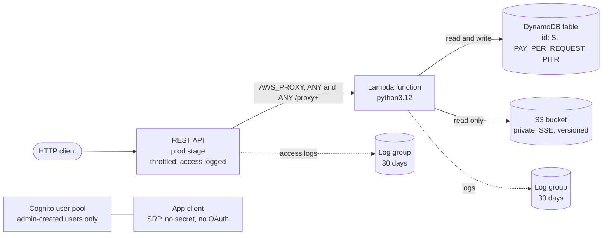

# Design Document

## Overview

This design adds a Python AWS CDK app in `infra/` that describes the Smart Customer Support Copilot's cloud resources in one stack: a Lambda function, a REST API, a DynamoDB table, an S3 bucket, and a Cognito user pool with one app client. Nothing is deployed. The only checks are pytest tests on the synthesized CloudFormation template and a manual `cdk synth`. The app in `src/smart_copilot/` is not touched.

Source documents: `.kiro/specs/cdk-stack/requirements.md` and `docs/brd-cdk.md`.

### Research summary and verification status

Every construct, property, and flag below was checked, not recalled. `aws-cdk-lib` is not yet in the project, so the checks ran in a throwaway virtual environment at `/tmp/cdkprobe` outside the repository, with `aws-cdk-lib` 2.278.0 and `constructs` 10.8.1 (the versions `uv`/pip resolved on the day of writing), and the installed CDK CLI 2.1148.1 on Node v24.22.3. A probe stack with these constructs ran `cdk synth` with exit code 0. The probe made no AWS call and ran no Account_Command. The probe stack lives only in `/tmp` and is not part of the deliverable.

Findings that shaped the design:

| Finding | Source | Effect on the design |
| --- | --- | --- |
| `dynamodb.TableV2` synthesizes `AWS::DynamoDB::GlobalTable`, with the point-in-time setting nested under `Replicas`. | Probe synth | Requirement 4 names `AWS::DynamoDB::Table`, so the design uses `dynamodb.Table`. |
| `dynamodb.Table` accepts both `point_in_time_recovery` (marked deprecated in the installed docstring) and `point_in_time_recovery_specification`. | Installed `aws-cdk-lib` signature and docstring | Use `point_in_time_recovery_specification=PointInTimeRecoverySpecification(point_in_time_recovery_enabled=True)`. |
| `UserPool.add_client` with default OAuth settings emits `AllowedOAuthFlows: [implicit, code]`, a placeholder `CallbackURLs` of `https://example.com`, and OAuth scopes. | Probe synth | Pass `disable_o_auth=True`. The re-run template had `AllowedOAuthFlowsUserPoolClient: false` and no flows, scopes, or callback URLs. |
| With the flags that `cdk init` writes, `@aws-cdk/aws-lambda:useCdkManagedLogGroup` makes CDK add a Lambda log group with `RetentionInDays: 731` and a `Retain` policy. | Probe synth with the `cdk init` context | Give the function an explicit log group (see Lambda). |
| With those flags, `@aws-cdk/aws-iam:minimizePolicies` merges the two DynamoDB statements into one. Without the flags, the grant produces two (the second holds `dynamodb:GetRecords` and `dynamodb:GetShardIterator`). | Probe synth, both ways | Tests must accept one or more DynamoDB statements. |
| `S3 enforce_ssl=True` renders `Principal` as `{"AWS": "*"}`, not the bare string `*`. | Probe synth | Requirement 5.3 says "Principal is `*`". The test matches `{"AWS": "*"}`, which is how CloudFormation spells the anonymous principal. |
| The probe template had no `Resource: "*"` statement, no `AWS::CDK::Metadata`, and no helper Lambda functions. | Probe synth | The Wildcard_Resource_Exception list is empty. |
| `cdk synth --help` lists `--no-version-reporting` (alias `--telemetry`, "Disable CLI telemetry and do not include the AWS::CDK::Metadata resource"), `--notices`, and `--app`. | `cdk synth --help`, CLI 2.1148.1 | Used in the manual synth command. |
| `cdk cli-telemetry --status` reported "disabled" with `CDK_DISABLE_CLI_TELEMETRY=true`, and reported "disabled" with `{"context": {"cli-telemetry": false}}` in `cdk.json`. A top-level `"cli-telemetry": false` key reported "enabled". | Run against the probe app | Use the `context` form. Documented in [Configure AWS CDK CLI telemetry](https://docs.aws.amazon.com/cdk/v2/guide/cli-telemetry.html). |
| API Gateway REST API access logging needs an account-level CloudWatch Logs role ARN, set once per Region. | [Execution logging for REST APIs](https://docs.aws.amazon.com/apigateway/latest/developerguide/rest-api-execution-logging.html) and [Set up CloudWatch logging](https://docs.aws.amazon.com/apigateway/latest/developerguide/set-up-logging.html) | Deploy-time prerequisite, see API Gateway. |

Content from the AWS documentation pages was rephrased for compliance with licensing restrictions.

### Still to check against the installed `aws-cdk-lib` once `uv add` has run

The project will pin whatever version `uv add` resolves, which may be newer than 2.278.0. The implementer re-verifies these items against `.venv/lib/python3.12/site-packages/aws_cdk/` and `uv run python -c "help(...)"`, and updates the design if any differ:

1. The `log_group` parameter of `lambda_.Function` (the signature shows `log_group: ILogGroupRef`; no stack was synthesized with it yet).
2. The `cloud_watch_role=False` result when the `disableCloudWatchRole` flag is also set (probe synth ran with `cloud_watch_role=False` and showed no `AWS::ApiGateway::Account` resource, both with and without the flag).
3. Every flag in the `cdk.json` context list against the installed library (the probe reported "1 feature flag is not configured" with the `cdk init` set, which is acceptable).
4. That the `"notices": false` key in `cdk.json` is honored. The CLI binary contains the string, but no run proved it. The manual command also passes `--no-notices`, which is the documented flag form of `--notices`.
5. That `uv run` started from `infra/` finds the root `pyproject.toml` and the `infra` group (uv's documented upward project discovery; not run yet because the group does not exist).
6. That the final synthesized template has no standalone 12-digit run and no helper Lambda.

## Architecture



The user pool and app client are not connected to the API. Requirement 3 and the BRD decision keep the API without an authorizer until a later spec moves sign-in to Cognito.

### Layout

```
infra/
├── app.py                         Entry point: create_app().synth()
├── cdk.json                       App command and context
└── smart_copilot_infra/
    ├── __init__.py
    ├── factory.py                 create_app(outdir) -> cdk.App
    └── stack.py                   SmartCopilotStack
tests/infra/
├── conftest.py                    Module-scoped synthesized template fixture
├── scanners.py                    Pure scanner functions (account ID, keys, wildcards)
├── test_scanners.py               Property tests for the scanners
└── test_stack.py                  Template tests, one group per requirement 1 to 8
```

Decisions:

- **`infra/` is not a package of `smart_copilot`.** The app is installed from `src/smart_copilot/`. The infra code is a separate top-level package `smart_copilot_infra` that nothing in `src/` imports. Requirement 13.2 stays true.
- **`create_app()` lives in `factory.py`, not `app.py`.** Tests need to build the app in memory with a temporary output folder. A top-level module named `app` would be a generic import name. `app.py` stays a five-line script.
- **Tests live in `tests/infra/`.** `structure.md` says tests mirror the package layout. `infra/` is a sibling of `src/`, so the mirror of `infra/smart_copilot_infra/` is `tests/infra/`. This keeps `tests/` as the one place pytest looks and keeps the `.hypothesis` and cache folders where they are.
- **`tests/infra/` has no `__init__.py`.** The existing `tests/` folder has none. With pytest's default import mode, helper modules in `tests/infra/` (`scanners.py`) import by basename, so the names `scanners` and `test_scanners` must stay unique across `tests/`. They are.

### Stack environment and name

`factory.create_app` builds `cdk.App(outdir=outdir)` and `SmartCopilotStack(app, "SmartCopilotStack", env=cdk.Environment(region="us-east-1"))`. No `account` is passed and no `CDK_DEFAULT_ACCOUNT` or `CDK_DEFAULT_REGION` is read. The synthesized manifest shows `"environment": "aws://unknown-account/us-east-1"` (probe result), and `Stack.account` resolves to the `AWS::AccountId` token. The stack name is `SmartCopilotStack` (the construct id; no `stack_name` is set).

`cdk.App(outdir=...)`: the `outdir` parameter and `app.synth()` are to be confirmed against the installed library at implementation (item list above, extended). When `cdk synth` runs the app, the CLI sets the output folder through its environment, so `outdir=None` is passed from `app.py`.

### `cdk.json` and how the app command resolves

`cdk synth` runs the `app` command with `infra/` as the working directory. The command is `uv run python app.py`. `uv run` finds the root `pyproject.toml` by searching upward, and `python app.py` puts `infra/` first on `sys.path`, so `import smart_copilot_infra` works with no install step.

```json
{
  "app": "uv run python app.py",
  "notices": false,
  "context": {
    "cli-telemetry": false,
    "@aws-cdk/aws-apigateway:disableCloudWatchRole": true,
    "...": "the remaining flags that `cdk init` wrote, verbatim"
  }
}
```

Context contents:

- The feature flags are the set that `cdk init app --language python --generate-only` wrote for CLI 2.1148.1 (run in `/tmp`, listed in the probe). The implementer copies that list, removes `watch`, and does not hand-pick flags, so the project matches a new CDK project of this CLI version. The flags that matter here are `@aws-cdk/aws-apigateway:disableCloudWatchRole`, `@aws-cdk/aws-iam:minimizePolicies`, `@aws-cdk/aws-lambda:useCdkManagedLogGroup`, `@aws-cdk/aws-s3:publicAccessBlockedByDefault`, `@aws-cdk/core:checkSecretUsage`, and `@aws-cdk/core:validateSnapshotRemovalPolicy`.
- `"cli-telemetry": false` sits under `context`, as verified with `cdk cli-telemetry --status`. This setting applies to the app and needs no account. The status command is a local read.
- No `account`, `env`, or lookup context key. `cdk.context.json` is not created (no lookups are used) and is not committed.

Telemetry, notices, and version reporting for the manual command, with no account access:

```
cd infra
CDK_DISABLE_CLI_TELEMETRY=true cdk synth --no-version-reporting --no-notices
```

`CDK_DISABLE_CLI_TELEMETRY=true` is the documented environment variable and takes precedence over context. `--no-version-reporting` is the flag in `cdk synth --help`. This matches the intent of the telemetry-off settings in `scripts/check.py` (`SEMGREP_SEND_METRICS=off`, `DO_NOT_TRACK=1`), which are for semgrep, not the CDK CLI. `scripts/check.py` is not changed.

### Dependencies and pytest wiring

- Add with `uv add --group infra aws-cdk-lib constructs` (`uv add --help` lists `--group <GROUP>`). `uv.lock` is written by `uv`. The runtime `dependencies` list is untouched (Requirement 11.2).
- Add `[tool.uv] default-groups = ["dev", "infra"]` to `pyproject.toml` (documented `tool.uv.default-groups` setting). Without it, a plain `uv run pytest` would not install the `infra` group and the infra tests would fail at import. This is not a dependency list, so Requirement 11.1 holds.
- Add `[tool.pytest.ini_options] pythonpath = ["infra"]` to `pyproject.toml`. This makes `smart_copilot_infra` importable in tests without a `sys.path` edit in a conftest. The implementer confirms the key against the installed pytest 9.x docs.
- Ruff: the project has no `[tool.ruff]` section, so a bare `ruff check` scans from the working directory. The Requirement 13.3 command names `infra` explicitly. `infra/cdk.out/` is covered by the `.gitignore` entry, which ruff honors by default. `.hypothesis/` and `playwright-output/` already exist untouched.
- `.gitignore`: append `infra/cdk.out/`. Also add `infra/cdk.context.json`? No. Only what Requirement 9.4 asks.

## Components and Interfaces

All constructs below were checked against the installed signatures in the probe environment (names are exact).

### `SmartCopilotStack(cdk.Stack)` in `stack.py`

One class, one `__init__(scope, construct_id, **kwargs) -> None`. Construct IDs are fixed strings so that logical IDs stay stable: `TicketsTable`, `KnowledgeBaseBucket`, `AppFunction`, `AppFunctionLogGroup`, `ApiAccessLogs`, `Api`, `UserPool`, `AppClient`.

### Lambda function (Requirement 2)

- `aws_lambda.Function`, `runtime=aws_lambda.Runtime.PYTHON_3_12`.
- `code=aws_lambda.Code.from_asset(str(SRC_DIR), exclude=["**/__pycache__", "**/*.pyc"])`, where `SRC_DIR = Path(__file__).resolve().parents[2] / "src"`. From `infra/smart_copilot_infra/stack.py`, `parents[2]` is the repository root, so the path does not depend on the working directory. The asset hash covers `src/`, so the template's `Code.S3Key` changes whenever app code changes. Tests must not pin the hash.
- `handler="smart_copilot.lambda_handler.handler"`. `src/smart_copilot/lambda_handler.py` does not exist, and the BRD forbids adding it. **A deployed function would fail at invoke time with an import error**, and the FastAPI dependencies are not bundled either. This is accepted because deploy is out of scope. The design records it so nobody deploys by mistake.
- `memory_size=512` (MB), `timeout=cdk.Duration.seconds(30)`. These sit inside the Requirement 2.4 ranges and stay under the API Gateway REST integration limit of 29 seconds only approximately; the later spec that adds Bedrock calls revisits them.
- `environment={"TICKETS_TABLE": table.table_name, "KB_BUCKET": bucket.bucket_name}`. Both render as `Ref` in the template (probe result). No other variable is set.
- `log_group=aws_lambda_log_group` where `AppFunctionLogGroup` is `logs.LogGroup(retention=logs.RetentionDays.ONE_MONTH, removal_policy=cdk.RemovalPolicy.DESTROY)`. Reason: the `cdk init` flag set makes CDK create a log group with 731-day retention and `Retain` when none is given. An explicit group has a finite retention and does not leave an orphan. It uses the plain `AWS::Logs::LogGroup` resource, not `logRetention`, so no helper Lambda and no custom resource appear.
- No `AWS::Lambda::Function` helper functions are expected. The probe template contained exactly one. The expected helper list is empty. Why this matters: `logRetention`, `auto_delete_objects`, and S3 notifications each add one.

### API Gateway (Requirement 3)

- `aws_apigateway.LambdaRestApi(handler=fn, proxy=True (default), cloud_watch_role=False, deploy_options=StageOptions(...))`. The probe template had `ANY /` and `ANY /{proxy+}` methods, both `AWS_PROXY`, and four `AWS::Lambda::Permission` resources (two are the console test invocation permissions that the construct adds).
- `StageOptions`:
  - `access_log_destination=apigateway.LogGroupLogDestination(api_log_group)`.
  - `access_log_format=apigateway.AccessLogFormat.json_with_standard_fields(caller=False, http_method=True, ip=False, protocol=True, request_time=True, resource_path=True, response_length=True, status=True, user=False)`. The format carries no client IP, caller, or user, so the log holds no personal data (`code-style.md` forbids logging customer data). The probe confirmed that `request_id` is always present.
  - `throttling_rate_limit=10`, `throttling_burst_limit=20`. These render as `MethodSettings` with `HttpMethod: "*"` and `ResourcePath: "/*"` (probe result). Burst is at least rate.
- Access log group `ApiAccessLogs`: `retention=ONE_MONTH`, `removal_policy=DESTROY`. Access logs are not ticket data, and a retained group would block a later redeploy of a stack with the same name. Table, bucket, and pool stay `RETAIN` because they hold data.
- **CloudWatch role decision.** `cloud_watch_role=False` is set on the construct, and the `disableCloudWatchRole` flag is on in `cdk.json`. Either alone gives the same result, and setting both makes the intent explicit and survives a flag edit. With both set, the template has no `AWS::ApiGateway::Account` and no API Gateway CloudWatch role, so Requirement 7.3 holds without an exception.
- **Deploy-time prerequisite (not part of this stack).** Stage access logging requires the account to have an API Gateway CloudWatch Logs role ARN set in its account settings, once per Region. Without it, a deploy of a stage with access logging fails. That setting belongs to the account, so this stack does not create it, and nobody sets it in this work. The later deploy spec must either confirm the account setting or turn on the construct's role. The README or deploy spec carries this note.

### DynamoDB (Requirement 4)

- `dynamodb.Table` (not `TableV2`, see the research table).
- `partition_key=dynamodb.Attribute(name="id", type=dynamodb.AttributeType.STRING)`.
- `billing_mode=dynamodb.BillingMode.PAY_PER_REQUEST`. No capacity properties are set, so no `ProvisionedThroughput` appears.
- `point_in_time_recovery_specification=dynamodb.PointInTimeRecoverySpecification(point_in_time_recovery_enabled=True)`.
- `removal_policy=cdk.RemovalPolicy.RETAIN`. The probe showed `DeletionPolicy: Retain` and `UpdateReplacePolicy: Retain`.
- `table_name` is not set, so CloudFormation generates the name and there is no name clash on redeploy.

### S3 (Requirement 5)

`s3.Bucket(block_public_access=s3.BlockPublicAccess.BLOCK_ALL, enforce_ssl=True, encryption=s3.BucketEncryption.S3_MANAGED, versioned=True, removal_policy=cdk.RemovalPolicy.RETAIN)`. `auto_delete_objects` is not set, because it adds a custom-resource Lambda and the bucket is retained anyway. The probe rendered all four public-access flags `true`, `SSEAlgorithm: AES256`, `Versioning Status: Enabled`, `Retain/Retain`, and a bucket policy with a `Deny` for `aws:SecureTransport = false`. `bucket_name` is not set.

### Cognito (Requirement 6)

- `cognito.UserPool(self_sign_up_enabled=False, sign_in_aliases=cognito.SignInAliases(username=True), password_policy=cognito.PasswordPolicy(min_length=12, require_lowercase=True, require_uppercase=True, require_digits=True, require_symbols=True), removal_policy=cdk.RemovalPolicy.RETAIN)`. The probe rendered `AllowAdminCreateUserOnly: true`, `MinimumLength: 12`, no `UsernameAttributes`, no `AliasAttributes`, and `Retain/Retain`.
- Client: `user_pool.add_client("AppClient", generate_secret=False, auth_flows=cognito.AuthFlow(user_srp=True), disable_o_auth=True)`. Rendered: `ExplicitAuthFlows: [ALLOW_USER_SRP_AUTH, ALLOW_REFRESH_TOKEN_AUTH]`, `GenerateSecret: false`, `AllowedOAuthFlowsUserPoolClient: false`.
- **Why SRP only.** A browser or other public client has no safe place for a secret, so the client has none. SRP proves knowledge of the password without sending it, which is why the plain `user_password` flow stays off. `admin_user_password` and `custom` stay off because nothing needs them. The hosted-UI OAuth flows are off because no spec has chosen the sign-in design yet, and the default would otherwise add a placeholder callback URL of `https://example.com`.
- No `CfnUserPoolUser`, no groups, no domain.

### Grants (Requirement 7)

`table.grant_read_write_data(fn)` and `bucket.grant_read(fn)`. Nothing else grants permissions, no `add_to_role_policy`, no `initial_policy`.

Expected IAM content of the template (probe-verified with the `cdk init` flags):

| Resource | Content |
| --- | --- |
| `AWS::IAM::Role` (function service role) | Trust for `lambda.amazonaws.com`. `ManagedPolicyArns` holds only `service-role/AWSLambdaBasicExecutionRole`. |
| `AWS::IAM::Policy` (function default policy) | Statement 1: `dynamodb:BatchGetItem`, `Query`, `GetItem`, `Scan`, `ConditionCheckItem`, `BatchWriteItem`, `PutItem`, `UpdateItem`, `DeleteItem`, `DescribeTable` on the table ARN only. Without the `minimizePolicies` flag, a second statement with `dynamodb:GetRecords` and `dynamodb:GetShardIterator` on the same ARN also appears. Statement 2: `s3:GetObject*`, `s3:GetBucket*`, `s3:List*` on the bucket ARN and `<bucket ARN>/*`. |
| `AWS::S3::BucketPolicy` | The SSL `Deny` statement. It is a resource policy, not an IAM identity policy. Its `Action` is `s3:*` with `Effect: Deny`, which Requirement 7.4 does not cover because the requirement lists only `AWS::IAM::Policy`, `AWS::IAM::ManagedPolicy`, and `AWS::IAM::Role` documents. |
| API Gateway | No role. |

The table has no secondary index, so the table statement has no `/index/*` resource.

**Wildcard_Resource_Exception list: empty.** No statement in the template has `Resource: "*"`. The `AWSLambdaBasicExecutionRole` managed policy that the role attaches grants log actions on a wildcard resource, but it is an AWS-managed policy referenced by ARN, so its document is not in the template. Requirement 7.3 explicitly allows it. If a future change adds a `*` resource, the test fails until this list names it.

## Data Models

There are no application data models. The one shape that matters is the table key schema: partition key `id` of type string, no sort key, no secondary indexes. Ticket attributes are schemaless in DynamoDB and are defined by the later spec that moves storage.

Test-side data:

- `Finding`: a plain `str` (or `tuple[str, str]` of check name and offending value) returned by each scanner. An empty list means clean.
- Synthesized template: `dict[str, Any]` from `Template.to_json()`.
- Scanner patterns (constants in `scanners.py`):
  - Standalone 12-digit run: `(?<![0-9A-Za-z])\d{12}(?![0-9A-Za-z])`.
  - Access key ID: `(?<![0-9A-Za-z])(AKIA|ASIA)[0-9A-Z]{16}(?![0-9A-Za-z])`. The requirement says "followed by 16 uppercase letters or digits" and does not state boundaries; the design adds the boundary on the left only to avoid matching inside 64-character hex hashes, and no right boundary, so a longer run starting with a key prefix is still reported. Implementer: keep the left boundary and drop the right one.
  - Private key header: `-----BEGIN (RSA |EC |DSA |OPENSSH |PGP )?PRIVATE KEY`.
  - Secret assignment in source: a Python assignment whose target name contains `password`, `secret`, or `token` (case-insensitive) and whose value is a string literal: `(?i)\b\w*(password|secret|token)\w*\s*=\s*["'][^"']+["']`.
  - Forbidden env var name: case-insensitive substring `PASSWORD`, `SECRET`, or `TOKEN`.

## Correctness Properties

*A property is a characteristic or behavior that should hold true across all valid executions of a system-essentially, a formal statement about what the system should do. Properties serve as the bridge between human-readable specifications and machine-verifiable correctness guarantees.*

Only the pure scanner functions in `tests/infra/scanners.py` suit property-based testing. The template checks test one fixed stack, so they are example tests (see Testing Strategy). After reflection, the 8.1 and 8.2 criteria share one scanner and one property, and 8.3, 8.4, and 2.6 split by what they scan (text patterns versus names), so four properties remain.

### Property 1: Standalone 12-digit runs are detected exactly

For any string built from arbitrary text segments, where a digit run of length `n` is placed between characters chosen from alphanumeric and non-alphanumeric sets, the account-ID scanner reports a finding if and only if the string contains a maximal digit run of exactly 12 digits whose neighbors (if any) are not letters or digits. Runs of 11 or 13 digits, and 12-digit runs that touch a letter or digit, are not reported. Strings with no digits are never reported.

**Validates: Requirements 8.1, 8.2, 8.5**

### Property 2: Credential patterns are detected and near-misses are not

For any text, and any `AKIA` or `ASIA` prefix followed by 16 uppercase letters or digits, embedding the key at a position preceded by a non-alphanumeric character makes the scanner report it. For any prefix followed by 15 or fewer such characters, or any other four-letter prefix, no key finding is reported. For any text containing a `-----BEGIN ... PRIVATE KEY` header the scanner reports it, and for any source line assigning a non-empty string literal to a name containing `password`, `secret`, or `token` in any letter case the scanner reports it, while assigning a non-literal (for example a call or a name) is not reported.

**Validates: Requirements 8.3, 8.4, 8.5**

### Property 3: Secret-like environment variable names are rejected

For any environment variable name, the name checker flags the name if and only if it contains `PASSWORD`, `SECRET`, or `TOKEN` as a substring in any letter case. For any mapping of names to values, the checker returns exactly the flagged names.

**Validates: Requirements 2.6, 8.3**

### Property 4: Wildcard actions and unlisted wildcard resources are detected

For any generated IAM policy document (statements with arbitrary action lists and resource values, where a resource or action can be `*`) and any allow list of exception descriptions, the policy checker reports every statement whose action list contains the exact value `*`, and every statement whose `Resource` is `*` (alone or inside a list) and does not match the allow list. It reports nothing for a document with no such statements, including an empty document. Actions such as `s3:*` or `dynamodb:Get*` are not the exact value `*` and are not reported by the action check.

**Validates: Requirements 7.4, 7.5**

## Error Handling

This feature has no runtime request handling. Failure behavior sits in the CDK app and the tests.

- **Synthesis failure.** `app.py` lets the exception propagate. Python prints the traceback to standard error, and `cdk synth` exits non-zero with the failure named (Requirement 9.3). The app does not catch exceptions.
- **Missing asset path.** `Code.from_asset` raises if `src/` does not exist. This is the intended error and is not caught.
- **Missing Node.** jsii starts a Node process for every `import aws_cdk`. If `node` is not on `PATH`, imports fail. The tests surface this error unchanged. They do not skip.
- **Template violations.** Each test asserts with a message that names the check, for example `"Requirement 4.3: BillingMode must be PAY_PER_REQUEST"`. Scanners return findings, and the test asserts `findings == []` with the findings in the failure message.
- **Never hide a failure.** No test is skipped, deleted, or weakened (Requirement 13.4).
- **Account safety.** The manual synth command and all tests are credential-free. If the CLI asks for credentials, that is a bug to report, not something to answer by supplying credentials.

## Testing Strategy

### Approach

- Unit and example tests build the stack in memory with `aws_cdk.assertions.Template.from_stack` and check it with `Template.has_resource_properties`, `Template.resource_count_is`, `Template.find_resources`, and the `Match` helpers (`Match.object_like`, `Match.array_with`, `Match.absent`, `Match.any_value`). Each assertion names its requirement in the message. The implementer confirms the exact method and matcher names against the installed `aws_cdk.assertions` package.
- A module-scoped fixture in `tests/infra/conftest.py` builds the app once with `create_app(outdir=<temp dir>)` and returns the stack and the `Template`. One synth per test module keeps the run short. The synth needs Node (jsii) and makes no network or AWS call. The tests pass with no AWS credentials (Requirement 10.2).
- Property tests use Hypothesis (already a dev dependency). Each property test runs at least 100 examples (`@settings(max_examples=100)` or more) and carries the tag comment `# Feature: cdk-stack, Property N: <text>`. Each of Properties 1 to 4 is implemented by one test. The repository's `.hypothesis/` directory already exists. Test modules do not touch real AWS.
- PBT does not apply to the template checks: they assert on one fixed template, so more generated inputs would add no coverage.

### Test map

| Requirement | Tests in `test_stack.py` |
| --- | --- |
| 1 | `create_app(tmp)` synth gives one stack artifact in the cloud assembly; its environment region is `us-east-1`; `stack.account` is an unresolved token (contains `AWS::AccountId`) and not 12 digits. Files `app.py`, `cdk.json`, and `stack.py` exist under `infra/`. |
| 2 | One `AWS::Lambda::Function` (and no others, so no helper). `Runtime == "python3.12"`. `Handler` equals `smart_copilot.lambda_handler.handler`. `MemorySize` is an int in 128 to 10240 and `Timeout` an int in 1 to 900. `Environment.Variables` has exactly the keys `TICKETS_TABLE` and `KB_BUCKET`, each a `Ref` to the table and bucket logical IDs. Env var names pass the name checker (Property 3). |
| 3 | One `AWS::ApiGateway::RestApi`, zero `AWS::ApiGatewayV2::Api`. A `Method` with `Integration.Type == "AWS_PROXY"` whose `Uri` references the function. A `Lambda::Permission` with principal `apigateway.amazonaws.com`. The stage's `AccessLogSetting.DestinationArn` is a `Fn::GetAtt` to an `AWS::Logs::LogGroup` logical ID that exists. `MethodSettings` has rate and burst limits above 0 with burst at least rate. |
| 4 | One `AWS::DynamoDB::Table`. `KeySchema == [{AttributeName: id, KeyType: HASH}]`. `AttributeDefinitions` has `id` of type `S`. `BillingMode == PAY_PER_REQUEST` and `ProvisionedThroughput` absent. `PointInTimeRecoverySpecification.PointInTimeRecoveryEnabled` is `true`. `DeletionPolicy` and `UpdateReplacePolicy` are `Retain`. |
| 5 | One `AWS::S3::Bucket` with all four public-access flags `true`, SSE configured, `Versioning Status == "Enabled"`, and `Retain/Retain`. A `BucketPolicy` with a `Deny`, principal `{"AWS": "*"}`, and `Bool aws:SecureTransport == "false"`. |
| 6 | One `AWS::Cognito::UserPool` with `AllowAdminCreateUserOnly == true`, `UsernameAttributes` and `AliasAttributes` absent, `MinimumLength >= 12`, `Retain/Retain`. One `UserPoolClient` whose `UserPoolId` is a `Ref` to the pool and `GenerateSecret` is `false` or absent. Zero `AWS::Cognito::UserPoolUser`. |
| 7 | Collect every `AWS::IAM::Policy` statement for the function role. DynamoDB statements: every action starts with `dynamodb:`, every resource is the table ARN `Fn::GetAtt` (or an `/index/*` join on it), and the union of actions includes read and write actions. S3 statement: actions are exactly the three read patterns with no `s3:Put*`, `s3:Delete*`, or `s3:*`, and resources are the bucket ARN and its `/*` join. No other statement exists. The function role's `ManagedPolicyArns` holds one entry ending in `AWSLambdaBasicExecutionRole`. No `AWS::ApiGateway::Account` resource and no second `AWS::IAM::Role`. The policy checker (Property 4) finds no `*` action and no `*` resource outside the empty exception list. |
| 8 | The account-ID scanner and key scanner run over `json.dumps(template)` and find nothing. The same scanners run over every `.py` and `.json` file in `infra/` (skipping `cdk.out/`), over `infra/cdk.json`, and there is no `AWS::SecretsManager::Secret` resource, and no `account` context key. The secret-assignment scanner runs over `infra/` source. |

Supporting tests:

- `test_scanners.py`: Properties 1 to 4 plus a few examples (a 64-character hex asset hash is not an account ID, `AWS::AccountId` is not a finding).
- Dependency test (Requirement 11): read `pyproject.toml` with `tomllib`; `aws-cdk-lib` and `constructs` appear in the `infra` group only, and the runtime list holds the same five entries as before (`boto3`, `fastapi`, `itsdangerous`, `python-multipart`, `uvicorn`).
- No test reads the asset hash or the exact table, bucket, or role logical IDs beyond the Ref targets it resolves by type.

### `cdk synth` as a manual checkpoint

`cdk synth` is run by the implementer from `infra/` and is not a pytest test. A subprocess test would need the CDK CLI on `PATH`, write `infra/cdk.out/`, and add seconds to each test run, while the in-memory `app.synth()` test already exercises the same Python code and the same cloud assembly writer. The manual run checks the part pytest cannot: `cdk.json`'s `app` command and the CLI itself. Command and expectations:

```
cd infra
CDK_DISABLE_CLI_TELEMETRY=true cdk synth --no-version-reporting --no-notices
```

Exit code 0, one template file in `infra/cdk.out/`, and `git status` shows nothing under `infra/cdk.out/`. `cdk deploy`, `cdk bootstrap`, `cdk diff`, `cdk destroy`, `cdk import`, and `cdk doctor` against an account are never run.

### Definition of done

`uv run pytest`, `uv run ruff check src tests scripts infra`, and `uv run check` all exit 0 and their real output is reported (Requirement 13.3). `uv run check` runs gitleaks and semgrep, which must be installed. If a tool is missing the check is reported as not run, and the work is not reported done. `scripts/check.py` scans `src`, `tests`, `scripts`, `docs`, and the config files, not `infra/`, and this feature does not change it. Whether to add `infra` to its scan list is a follow-up for the user to decide.

## Steering Rule Updates (Requirement 12)

Edits are limited to the lines below. All other lines stay unchanged (Requirement 12.6). The implementer reads each file again before editing.

### `.kiro/steering/tech.md`

Replace the AWS list line and the "Not in scope" bullet.

1. In `## AWS`, replace
   `- Use AWS only when a spec asks for it. Allowed: Bedrock, Lambda, API Gateway, DynamoDB, S3. Region \`us-east-1\`.`
   with
   `- Use AWS only when a spec asks for it. Allowed: Bedrock, Lambda, API Gateway, DynamoDB, S3, and Amazon Cognito (infrastructure definitions only). Region \`us-east-1\`.`
2. In `## AWS`, add after the Bedrock rate bullet:
   `- A CDK app in \`infra/\` is allowed for \`cdk synth\` and template tests only. \`cdk deploy\`, \`cdk bootstrap\`, \`cdk destroy\`, \`cdk diff\` against an account, and every other command that reads or changes an AWS account stay forbidden without the user's approval.`
3. In `## Not in scope`, replace `- No CDK, SAM, Terraform, deploy steps, or slides.` with
   `- No SAM, Terraform, deploy steps, or slides. CDK is limited as stated in the AWS section.`

### `.kiro/steering/verify-first.md`

1. In `## AWS and Bedrock`, replace
   `- Use an AWS service only when a spec names it. Allowed: Bedrock, Lambda, API Gateway, DynamoDB, S3. Region \`us-east-1\`.`
   with
   `- Use an AWS service only when a spec names it. Allowed: Bedrock, Lambda, API Gateway, DynamoDB, S3, and Amazon Cognito (infrastructure definitions only). Region \`us-east-1\`.`
2. In `## AWS and Bedrock`, add after the "Do not make AWS calls..." bullet:
   `- A CDK app in \`infra/\` is allowed for \`cdk synth\` and template tests only. \`cdk deploy\`, \`cdk bootstrap\`, \`cdk destroy\`, \`cdk diff\` against an account, and every other command that reads or changes an AWS account stay forbidden without the user's approval.`
3. In `## Project facts`, replace `- Do not add CDK, SAM, Terraform, deploy steps, or slides.` with
   `- Do not add SAM, Terraform, deploy steps, or slides. CDK is allowed only as stated in the AWS and Bedrock section.`

### `.kiro/steering/product.md`

In `## Out of scope until an approved spec adds it`, replace
`- Any AWS service other than Bedrock, Lambda, API Gateway, DynamoDB, and S3.`
with
`- Any AWS service other than Bedrock, Lambda, API Gateway, DynamoDB, S3, and Amazon Cognito. Cognito is allowed for infrastructure definitions only.`

The "user login" bullet stays: this feature defines no sign-in behavior.

### `.kiro/steering/structure.md`

In the layout block, add after the `docs/` line:
`├── infra/                 CDK app (synth and template tests only). Not deployed.`
The `tests/` line stays as is. The Rules section stays unchanged. The new `tests/infra/` folder falls under the existing mirror rule.

## Risks and Open Points

- **Library and CLI skew.** The probe passed with `aws-cdk-lib` 2.278.0 and CLI 2.1148.1 (cloud assembly schema 55.x). If `uv add` resolves a newer library that needs a newer cloud assembly schema than the CLI supports, `cdk synth` fails with a schema-version error. The in-memory tests would still pass. The manual checkpoint exists to catch this. Remedy: pin `aws-cdk-lib` to the last version that the CLI accepts.
- **Requirement wording.** Requirement 5.3 says the SSL deny `Principal` is `*`, while CloudFormation renders `{"AWS": "*"}`. The test accepts that form. No requirement change is needed, and `requirements.md` is not edited here.
- **Deprecated property.** `point_in_time_recovery` is deprecated, so the design uses the specification form. The `TableV2` class is not used, because it produces a different resource type than Requirement 4 names.
- **Deployed behavior.** The function cannot run until a later spec adds the handler, the Lambda adapter, and bundled dependencies. The API has no authorizer. Both are accepted by the BRD.

## Implementation Notes (verified after `uv add`)

These results replace the "Still to check" list above.

- **Versions.** `uv add --group infra aws-cdk-lib constructs` resolved `aws-cdk-lib` 2.278.0 and `constructs` 10.8.1, the same as the probe. `cdk synth` with CLI 2.1148.1 exits 0, so there is no cloud assembly schema mismatch.
- **Signatures.** `lambda_.Function(log_group=...)`, `cdk.App(outdir=...)`, `app.synth()`, and the `aws_cdk.assertions` names (`Template.from_stack`, `has_resource_properties`, `resource_count_is`, `find_resources`, `to_json`, `Match.object_like`, `array_with`, `absent`, `any_value`) exist in the installed library.
- **`default-groups` is needed before the first sync.** Without `[tool.uv] default-groups`, `uv sync` removed the `infra` group and `import aws_cdk` failed.
- **`AWS::CDK::Metadata`.** The in-memory synth had none, but `cdk synth --no-version-reporting` still added it. `create_app` now passes `analytics_reporting=False`, and `test_cli_context_cannot_turn_on_version_reporting` checks it. With that, the CLI template has no `AWS::CDK::Metadata`.
- **Feature flags.** `cdk.json` holds the 89 flags that `cdk init` wrote for CLI 2.1148.1, plus `cli-telemetry: false`. `cdk flags --unstable=flags` reports one more flag that the newer library knows: `@aws-cdk/aws-iam:importedUserAndGroupStackSafeDefaultPolicyName` (recommended `true`, effective `false`). It only affects imported IAM users and groups, which this stack does not use. It is left unset, as the design says not to hand-pick flags, and `cdk synth` prints a one-line notice about it.
- **Test fixtures file.** The infra fixtures live in `tests/infra/infra_fixtures.py`, not `tests/infra/conftest.py`. A second `conftest.py` made `from conftest import sign_in` in `tests/test_tickets_api.py` import the infra one. The fixtures are registered with `name=` so the test parameters do not shadow imports (ruff F811).
- **Bootstrap parameter.** The synthesized template has the standard `BootstrapVersion` parameter, an SSM parameter reference that CloudFormation resolves only at deploy time. It holds no account ID.
- **gitleaks and `infra/cdk.out/`.** gitleaks' `generic-api-key` rule matches the 64-character asset hash (`S3Key`) in `infra/cdk.out/`. Those files are generated and git-ignored, but `gitleaks dir` does not honor `.gitignore`. Delete `infra/cdk.out/` before `uv run check`, or decide whether `scripts/check.py` should exclude it.
- Final template: one stack `aws://unknown-account/us-east-1`, 22 resources, one `AWS::Lambda::Function`, no `Custom::` resources, no `AWS::ApiGateway::Account`, no `Resource: "*"` statement, and no standalone 12-digit run.
